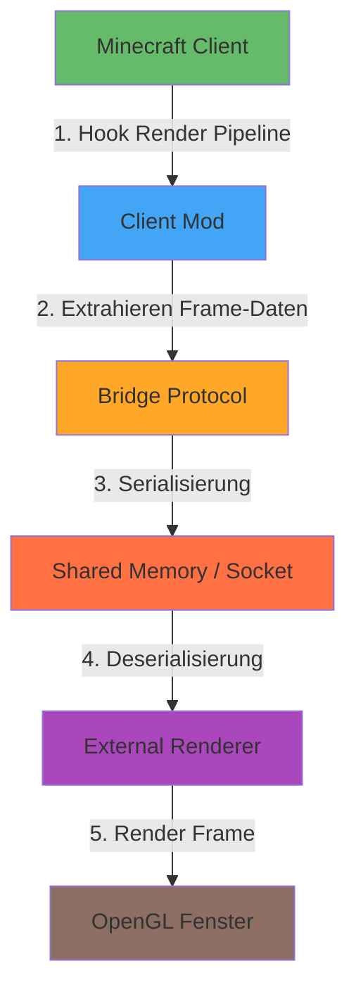

# Minecraft 1.8.9 External Renderer (rend)

[](https://opensource.org/licenses/MIT)
[]
[]

**rend** ist ein experimentelles Projekt, das den integrierten Renderer von Minecraft 1.8.9 durch einen externen Rendering-Prozess ersetzt. Das Projekt besteht aus drei Hauptkomponenten:

- **Client-Mod**: Forge-Mod, der die Render-Pipeline hookt und Daten extrahiert
- **Bridge-Protokoll**: Binäres Protokoll für die Kommunikation zwischen Client und Renderer
- **Externer Renderer**: Separates Programm, das die Szene eigenständig rendert

## Architektur-Übersicht



### Datenfluss pro Frame

```
Minecraft Render Pipeline
         |
         v
[EntityRenderer.updateCameraAndRender]
         |
         v
[Client Mod Hook] --> Kamera-Daten extrahieren
         |                     (Position, Rotation, FOV, Projection-Matrix)
         v
[RenderGlobal] --> Chunk/Entity Meshes extrahieren
         |
         v
[Bridge Serializer] --> Binäre Frame-Daten
         |
         v
[Transport Layer] --> Shared Memory Ring-Buffer
         |
         v
[External Renderer] --> OpenGL Rendering
```

## Projekt-Struktur

```
rend/
├── bridge-protocol/          # Protokoll-Definition und Transport
│   ├── src/main/java/renderbridge/protocol/
│   │   ├── messages/         # Message-Typen und Serialisierung
│   │   ├── transport/        # Transport-Implementierungen
│   │   └── codec/            # Codecs für Binär-Daten
│   └── src/test/java/        # Unit-Tests
│
├── mc-client-mod/            # Minecraft Forge Client-Mod
│   ├── src/main/java/renderbridge/mod/
│   │   ├── hooks/            # Render-Pipeline Hooks
│   │   ├── extractors/       # Daten-Extraktoren
│   │   └── bridge/           # Bridge-Client
│   └── src/main/resources/   # Mod-Konfiguration
│
├── external-renderer/        # Externer Renderer
│   ├── src/main/java/renderbridge/renderer/
│   │   ├── gl/               # OpenGL Rendering
│   │   ├── scene/            # Szene-Verwaltung
│   │   └── bridge/           # Bridge-Client
│   └── src/main/resources/   # Shader, Konfiguration
│
└── docs/                     # Dokumentation
    ├── architecture.md       # Detaillierte Architektur
    ├── protocol.md           # Protokoll-Spezifikation
    └── adr/                  # Architecture Decision Records
```

## Voraussetzungen

- Java JDK 8 (für Minecraft 1.8.9 Kompatibilität)
- Forge für Minecraft 1.8.9 (1.8.9-11.15.1.2318-1.8.9)
- Gradle 6.x+ (für Build-System)
- LWJGL 2 (wird von Forge bereitgestellt)

## Setup und Build

### 1. Repository klonen

```bash
git clone https://github.com/GOPROSCOUSIN100/rend.git
cd rend
```

### 2. Bridge-Protokoll bauen

```bash
cd bridge-protocol
./gradlew build
```

### 3. Client-Mod bauen

```bash
cd mc-client-mod
./gradlew build
```

Die gebaute Mod-JAR findet sich in `mc-client-mod/build/libs/`.

### 4. Externen Renderer bauen

```bash
cd external-renderer
./gradlew build
```

Der Renderer-JAR findet sich in `external-renderer/build/libs/`.

### 5. Client-Mod installieren

1. Kopiere die Mod-JAR in den `mods/` Ordner deiner Minecraft-Installation
2. Starte Minecraft mit Forge 1.8.9

### 6. Externen Renderer starten

```bash
java -jar external-renderer/build/libs/external-renderer-*.jar
```

## Roadmap

### ✅ Phase 1: Projekt-Setup (LAUFEND)
- [x] Repository-Struktur erstellen
- [x] README.md
- [x] CONTRIBUTING.md
- [x] Architektur-Dokumentation
- [x] ADRs für technische Entscheidungen
- [ ] Build-Systeme einrichten
- [ ] GitHub Issues für alle Phasen

### 📋 Phase 2: Protokoll-Prototyp
- [ ] Binäres Protokoll-Design finalisieren
- [ ] Message-Typen definieren
- [ ] Serialisierung/Deserialisierung implementieren
- [ ] Shared Memory Transport
- [ ] Socket-Transport (Fallback)
- [ ] Handshake und Version-Aushandlung
- [ ] Heartbeat-Mechanismus
- [ ] Roundtrip-Test (Echo)
- [ ] Unit-Tests für alle Komponenten

### 📋 Phase 3: Client-Mod Datenquelle
- [ ] Forge-Mod Grundgerüst
- [ ] Render-Pipeline Hook (EntityRenderer)
- [ ] Kamera-Daten Extraktion
- [ ] Chunk/Block-Daten Extraktion
- [ ] Entity-Daten Extraktion
- [ ] Partikel-Daten Extraktion
- [ ] Fallback-Rendering (wenn Bridge offline)
- [ ] Bridge-Integration

### 📋 Phase 4: Externer Renderer
- [ ] LWJGL 2 Fenster erstellen
- [ ] OpenGL Kontext initialisieren
- [ ] Bridge-Client implementieren
- [ ] Szene-Daten empfangen
- [ ] Kamera aus übertragenen Matrizen steuern
- [ ] Einfaches Voxel-Mesh rendern
- [ ] Frame-Rate Synchronisation

### 📋 Phase 5: Ausbau
- [ ] Entity-Rendering
- [ ] Block-Texturen (über Ressourcenpakete)
- [ ] GUI/HUD-Overlay
- [ ] Wetter-Effekte
- [ ] Performance-Messung
- [ ] Latenz-Optimierung

### 📋 Phase 6: Stabilisierung
- [ ] Fehlerbehandlung verbessern
- [ ] Reconnect-Logik
- [ ] Protokoll-Versionierung dokumentieren
- [ ] Release-Tag erstellen
- [ ] Benutzer-Dokumentation

## Lizenz

Dieses Projekt steht unter der MIT-Lizenz. Siehe [LICENSE](LICENSE) für Details.

## Rechtliche Hinweise

- Dieses Projekt enthält **keine** Minecraft-Assets
- Kein dekompilierter Mojang-Code
- Der Mod läuft nur in einer Forge-Dev-Umgebung gegen die Nutzer-Installation
- Auf echten Servern kann der Mod als Cheat erkannt werden (Anti-Cheat-Kompatibilität)

## Beitragen

Siehe [CONTRIBUTING.md](CONTRIBUTING.md) für Details zum Arbeitsablauf.

---

*Projekt-Status: Aktive Entwicklung (Phase 1)*
