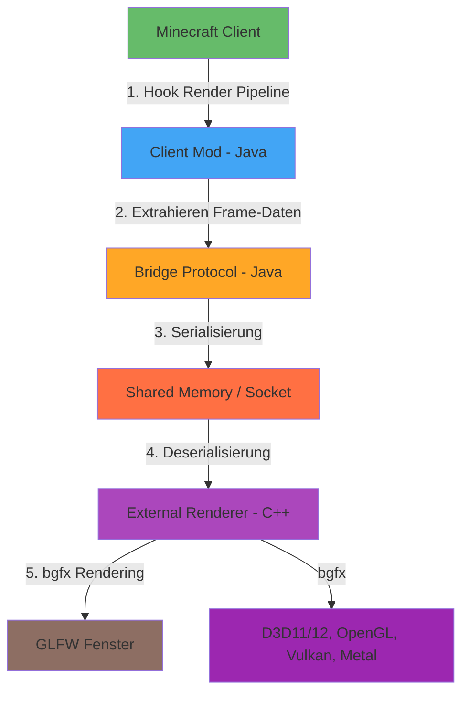

# Minecraft 1.8.9 External Renderer (rend)

[](https://opensource.org/licenses/MIT)
[](https://opensource.org/licenses/MIT)
[]
[](https://github.com/bkaradzic/bgfx)
[](https://www.glfw.org/)

**rend** ist ein experimentelles Projekt, das den integrierten Renderer von Minecraft 1.8.9 durch einen externen Rendering-Prozess ersetzt. Das Projekt besteht aus drei Hauptkomponenten:

- **Client-Mod (Java/Forge)**: Forge-Mod, der die Render-Pipeline hookt und Daten extrahiert
- **Bridge-Protokoll (Java)**: Binaeres Protokoll fuer die Kommunikation zwischen Client und Renderer
- **Externer Renderer (C++/bgfx)**: Separates C++-Programm mit bgfx, das die Szene eigenstaendig rendert

## Architektur-Uebersicht



### Datenfluss pro Frame

```
Minecraft Render Pipeline (Java)
         |
         v
[EntityRenderer.updateCameraAndRender]
         |
         v
[Client Mod Hook] --> Kamera-Daten extrahieren
         |                     (Position, Rotation, FOV, Projection-Matrix)
         v
[RenderGlobal] --> Chunk/Entity Meshes extrahieren
         |
         v
[Bridge Serializer] --> Binaere Frame-Daten (Big-Endian)
         |
         v
[Transport Layer] --> Shared Memory Ring-Buffer / Local Socket
         |
         v
[C++ Bridge Client] --> Nachrichten parsen
         |
         v
[Protocol Adapter] --> bgfx Vertex/Index Buffer erstellen
         |
         v
[bgfx Renderer] --> Multi-Backend Rendering (D3D11/12, OpenGL, Vulkan, Metal)
         |
         v
[GLFW Window] --> Fenster und Input Handling
```

## Projekt-Struktur

```
rend/
├── bridge-protocol/          # Protokoll-Definition und Transport (Java)
│   ├── src/main/java/renderbridge/protocol/
│   │   ├── messages/         # Message-Typen und Serialisierung
│   │   ├── transport/        # Transport-Implementierungen
│   │   └── codec/            # Codecs fuer Binaer-Daten
│   └── src/test/java/        # Unit-Tests
│
├── mc-client-mod/            # Minecraft Forge Client-Mod (Java)
│   ├── src/main/java/renderbridge/mod/
│   │   ├── hooks/            # Render-Pipeline Hooks
│   │   ├── extractors/       # Daten-Extraktoren
│   │   └── bridge/           # Bridge-Client
│   └── src/main/resources/   # Mod-Konfiguration
│
├── external-renderer-cpp/    # Externer Renderer (C++/bgfx)
│   ├── CMakeLists.txt         # CMake Build-Konfiguration
│   ├── src/
│   │   ├── main.cpp/main.hpp              # Haupteinstiegspunkt
│   │   ├── window.hpp/cpp                # GLFW Fensterverwaltung
│   │   ├── input_handler.hpp/cpp         # Eingabe-Verarbeitung
│   │   ├── bridge/                       # Bridge-Client
│   │   │   ├── renderer_bridge_client.hpp/cpp
│   │   │   ├── bridge_connection.hpp/cpp
│   │   │   └── message_handler.hpp/cpp
│   │   ├── scene/                        # Szene-Klassen
│   │   │   ├── scene.hpp/cpp
│   │   │   ├── camera.hpp/cpp
│   │   │   ├── chunk.hpp/cpp
│   │   │   ├── entity.hpp/cpp
│   │   │   ├── particle.hpp/cpp
│   │   │   └── weather.hpp/cpp
│   │   ├── renderer/                     # Renderer
│   │   │   ├── renderer.hpp/cpp
│   │   │   ├── voxel_renderer.hpp/cpp
│   │   │   ├── entity_renderer.hpp/cpp
│   │   │   └── particle_renderer.hpp/cpp
│   │   ├── adapter/                      # Protokoll-Adapter
│   │   │   └── protocol_adapter.hpp/cpp
│   │   └── utils/                        # Hilfsklassen
│   │       ├── byte_buffer.hpp/cpp
│   │       └── logger.hpp/cpp
│   ├── shaders/                         # Shader-Dateien
│   │   ├── vs_voxel.sc/fs_voxel.sc
│   │   ├── vs_entity.sc/fs_entity.sc
│   │   └── vs_particle.sc/fs_particle.sc
│   ├── cmake/
│   │   └── Findbgfx.cmake
│   └── 3rdparty/
│       └── bgfx/                        # Git-Submodul
│
├── docs/                              # Dokumentation
│   ├── architecture.md                # Detaillierte Architektur
│   ├── protocol.md                    # Protokoll-Spezifikation
│   └── adr/                           # Architecture Decision Records
│       ├── ADR-001-hook-method-selection.md
│       ├── ADR-002-transport-medium-selection.md
│       ├── ADR-003-protocol-design.md
│       ├── ADR-004-build-system.md
│       ├── ADR-005-rendering-engine-selection.md
│       └── ADR-006-window-library-selection.md
│
├── THIRD-PARTY-NOTICES.md             # Drittanbieter-Lizenzen
└── README.md
```

## Voraussetzungen

### Java-Seite (Client-Mod, Bridge-Protokoll)
- Java JDK 8 (fuer Minecraft 1.8.9 Kompatibilitaet)
- Forge fuer Minecraft 1.8.9 (1.8.9-11.15.1.2318-1.8.9)
- Gradle 6.x+ (fuer Build-System)
- LWJGL 2 (wird von Forge bereitgestellt)

### C++-Seite (Externer Renderer)
- C++17 Compiler (GCC 7+, Clang 5+, MSVC 2017+)
- CMake 3.15+
- Git (fuer bgfx Submodule)
- Python 3 (fuer Shader-Compiler)
- GLFW 3.3+ (Fensterverwaltung)
- Grafik-Treiber fuer gewuenschte Backends:
  - Windows: DirectX 11/12, OpenGL 4.5+, Vulkan
  - Linux: OpenGL 4.5+, Vulkan, Wayland/X11
  - macOS: Metal, OpenGL 4.1+

## Setup und Build

### 1. Repository klonen

```bash
git clone https://github.com/GOPROSCOUSIN100/rend.git
cd rend
```

### 2. Bridge-Protokoll bauen

```bash
cd bridge-protocol
./gradlew build
```

### 3. Client-Mod bauen

```bash
cd mc-client-mod
./gradlew build
```

Die gebaute Mod-JAR findet sich in `mc-client-mod/build/libs/`.

### 4. Externen C++-Renderer bauen

#### bgfx Submodule initialisieren
```bash
cd external-renderer-cpp
git submodule update --init --recursive
```

#### CMake Build (Linux/macOS)
```bash
cd external-renderer-cpp
mkdir -p build && cd build
cmake .. -DCMAKE_BUILD_TYPE=Release
cmake --build . -j$(nproc)
```

#### CMake Build (Windows - Visual Studio)
```bash
cd external-renderer-cpp
mkdir -p build && cd build
cmake .. -G "Visual Studio 16 2019" -A x64
cmake --build . --config Release
```

#### CMake Build (Windows - MinGW)
```bash
cd external-renderer-cpp
mkdir -p build && cd build
cmake .. -G "MinGW Makefiles" -DCMAKE_C_COMPILER=gcc -DCMAKE_CXX_COMPILER=g++
cmake --build .
```

Der Renderer-Executable findet sich in `external-renderer-cpp/build/bin/`.

### 5. Client-Mod installieren

1. Kopiere die Mod-JAR in den `mods/` Ordner deiner Minecraft-Installation
2. Starte Minecraft mit Forge 1.8.9

### 6. Externen Renderer starten

#### Linux/macOS
```bash
cd external-renderer-cpp/build/bin
./renderbridge-renderer
```

#### Windows
```cmd
cd external-renderer-cpp\build\bin\Release
renderbridge-renderer.exe
```

Der Renderer versucht automatisch, sich mit dem Mod zu verbinden. Standardmaessig wird Shared Memory verwendet, mit Fallback auf Local Socket (Port 25565).

## Roadmap

### ✅ Phase 1: Projekt-Setup (ABGESCHLOSSEN)
- [x] Repository-Struktur erstellen
- [x] README.md
- [x] CONTRIBUTING.md
- [x] Architektur-Dokumentation
- [x] ADRs fuer technische Entscheidungen
- [x] Build-Systeme einrichten (Gradle + CMake)
- [x] GitHub Issues fuer alle Phasen

### ✅ Phase 2: Protokoll-Prototyp (ABGESCHLOSSEN)
- [x] Binaeres Protokoll-Design finalisieren
- [x] Message-Typen definieren (15 Typen)
- [x] Serialisierung/Deserialisierung implementieren
- [x] Shared Memory Transport (Ring-Buffer)
- [x] Socket-Transport (Fallback)
- [x] Handshake und Version-Aushandlung
- [x] Heartbeat-Mechanismus
- [x] Roundtrip-Test (Echo)
- [x] Unit-Tests fuer alle Komponenten

### ✅ Phase 3: Client-Mod Datenquelle (ABGESCHLOSSEN)
- [x] Forge-Mod Grundgeruest
- [x] Render-Pipeline Hook (EntityRenderer, RenderGlobal, Framebuffer)
- [x] Kamera-Daten Extraktion
- [x] Chunk/Block-Daten Extraktion
- [x] Entity-Daten Extraktion
- [x] Partikel-Daten Extraktion
- [x] Wetter-Daten Extraktion
- [x] GUI-Status Extraktion
- [x] Fallback-Rendering (wenn Bridge offline)
- [x] Bridge-Integration
- [x] Konfiguration (Forge Config)

### 🚧 Phase 4: Externer C++/bgfx Renderer (IN BEARBEITUNG)
- [x] C++ Projektstruktur mit CMake
- [x] bgfx als Git-Submodul eingebunden
- [x] GLFW fuer Fensterverwaltung
- [x] bgfx Initialisierung mit Multi-Backend
- [x] C++ Bridge-Client (Shared Memory + Socket)
- [x] Message Handler fuer alle Nachrichtentypen
- [x] Szene-Klassen (Scene, Camera, Chunk, Entity, Particle, Weather)
- [x] ProtocolAdapter fuer bgfx-Uebersetzung
- [x] Vertex/Index-Buffer Verwaltung
- [x] Shader-Dateien (.sc Format)
- [x] CMake Shader-Kompilierung
- [x] Renderer-Klassen (Voxel, Entity, Particle)
- [x] Hauptanwendung (main.cpp)
- [x] ADR-005 (bgfx-Auswahl)
- [x] ADR-006 (GLFW-Auswahl)
- [x] THIRD-PARTY-NOTICES.md
- [ ] Shader binaries generieren (waehrend Build)
- [ ] Textur-Handling implementieren
- [ ] Uniform-Handling implementieren
- [ ] Mesh-Generierung fuer Chunks
- [ ] Mesh-Generierung fuer Entities
- [ ] Partikel-Rendering implementieren
- [ ] Wetter-Effekte implementieren
- [ ] Debug-Overlay (FPS, Status)
- [ ] Fallback-Anzeige bei Verbindungsverlust
- [ ] Performance-Optimierung

### 📋 Phase 5: Ausbau
- [ ] Entity-Rendering mit Texturen
- [ ] Block-Texturen (ueber Ressourcenpakete)
- [ ] GUI/HUD-Overlay
- [ ] Wetter-Effekte (Regen, Schnee)
- [ ] Performance-Messung
- [ ] Latenz-Optimierung
- [ ] Anti-Aliasing
- [ ] Post-Processing Effekte

### 📋 Phase 6: Stabilisierung
- [ ] Fehlerbehandlung verbessern
- [ ] Reconnect-Logik
- [ ] Protokoll-Versionierung dokumentieren
- [ ] Release-Tag erstellen (v0.2.0)
- [ ] Benutzer-Dokumentation
- [ ] CI/CD Pipeline einrichten

## Lizenzen

### Projekt-Lizenz
Dieses Projekt steht unter der **MIT-Lizenz**. Siehe [LICENSE](LICENSE) fuer Details.

### Drittanbieter-Bibliotheken
Dieses Projekt verwendet folgende Drittanbieter-Bibliotheken:

- **bgfx** (BSD-2-Clause) - Rendering-Engine
- **GLFW** (zlib/Libpng License) - Fensterverwaltung
- **ForgeGradle/RetroFuturaGradle** (MIT) - Build-System fuer Mod
- **LWJGL 2** (BSD) - OpenGL-Bindings fuer Minecraft

Alle Lizenzen und Copyright-Hinweise sind in [THIRD-PARTY-NOTICES.md](THIRD-PARTY-NOTICES.md) dokumentiert.

## Rechtliche Hinweise

- Dieses Projekt enthaelt **keine** Minecraft-Assets
- Kein dekompilierter Mojang-Code
- Der Mod laeuft nur in einer Forge-Dev-Umgebung gegen die Nutzer-Installation
- Auf echten Servern kann der Mod als Cheat erkannt werden (Anti-Cheat-Kompatibilitaet)

## Beitragen

Siehe [CONTRIBUTING.md](CONTRIBUTING.md) fuer Details zum Arbeitsablauf.

---

*Projekt-Status: Aktive Entwicklung (Phase 4 - C++/bgfx Renderer)*

*Letzte Aktualisierung: bgfx-Integration und C++-Struktur erstellt*
